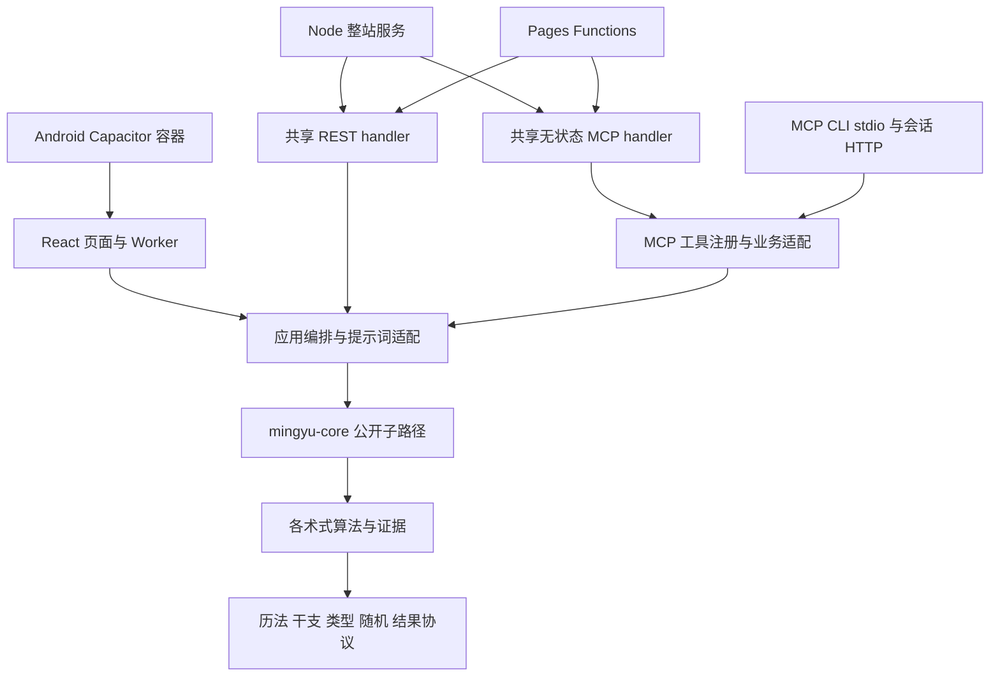

# 系统地图、历史抽样与审查覆盖

日期：2026-10-26。基线：`6d0aaa10730ad156bb73a053a6e04b67b26d8c91`。

主文档：[维护复杂度系统排查报告](2026-10-26-maintainability-review.md)。方法：[排查计划](2026-10-26-plan.md)。

## 1. 当前运行面与依赖

图表示主要职责关系，不是完整静态依赖图。部分纯工具可直接调用核心；核心高层入口也聚合多个领域。它揭示了本轮重要边界：算法共享不代表请求业务已统一；多运行时入口也不必然重复业务。

| 运行面 | 已核实入口 | 关键职责与边界 |
| --- | --- | --- |
| Web | `src/main.tsx` → `src/App.tsx` | 页面、URL 状态、Worker、历史和 AI 会话 |
| 核心库 | `packages/core/src/index.ts` 及 package exports | 纯计算、跨体系组合、提示词、稳定数据与协议；75 个公开子路径 |
| REST | `src/lib/public-api/handler.ts` | 路由、输入解释、OpenAPI、领域投影、提示词及在线预算 |
| Node 整站 | `server/docker-server.ts` | 静态/SPA、共享 REST、无状态 MCP、AI、运行时配置 |
| Pages | `functions/api/v1/[[path]].ts`、`functions/mcp.ts`、`functions/_middleware.ts` | 薄适配、静态发现及在线预设 |
| 在线 MCP | `src/lib/mcp/handler.ts` → `mcp/src/create-server.ts` | 无状态 JSON-RPC、目标工具注册、预设与工具目录 |
| MCP CLI | `mcp/src/server.ts`、`mcp/src/http-server.ts` | stdio 与会话式 Streamable HTTP；不能与在线入口混为一种生命周期 |
| MCP npm 包 | `packages/mcp/package.json` | 只有发布包装；实现由 `vite.mcp.config.ts` 从 `mcp/src` 打入 dist |
| Android | `android/app/src/main/java/cc/aov/mingyu/MainActivity.java` 等 | 同一 Web 产物加原生 AI、应用唤起与更新插件 |

Node 与 Pages 已共享 REST/无状态 MCP handler。Pages `tools/list` 通过 `ASSETS` 读构建时目录；Node MCP 不依赖该加载器，但整站仍对外提供目录静态文件。官方 Node 部署继续设置 online 预设，不能由迁出 Pages 推断在线范围保护已废弃。

## 2. 体量与排除口径

统计 Git 受控第一方文件。近似有效行数（ELOC）去掉空行和纯注释行，保留类型、schema、规则判定与注册代码。不是 AST 或圈复杂度分析；混合文件中的常量和文本仍计入。独立资料模块中少量 getter 随资料排除。

| 范围 | 文件 | 近似 ELOC |
| --- | ---: | ---: |
| 核心 `packages/core/src` | 466 | 137,098 |
| Web 与共享应用 `src` | 254 | 70,587 |
| MCP `mcp/src` | 42 | 8,206 |
| Node 适配 | 1 | 401 |
| Edge 适配 | 5 | 183 |
| Android 主逻辑 Java | 6 | 1,015 |
| 公开运行 JS | 2 | 84 |
| 运行逻辑合计 | 776 | 217,574 |
| 工程脚本与构建 | 38 | 10,288 |
| 测试及代码夹具，含 Android | 497 | 155,254 |

| 主要子系统 | 文件 | 近似 ELOC |
| --- | ---: | ---: |
| core/divination | 85 | 43,414 |
| core/bazi | 229 | 32,275 |
| core/prompt | 30 | 11,070 |
| core/ziwei | 28 | 9,504 |
| core/calendar | 16 | 4,966 |
| core/qi_zheng | 8 | 4,766 |
| src/pages | 65 | 20,996 |
| src/components | 35 | 13,845 |
| src/lib/ai | 26 | 11,680 |
| src/lib/public-api | 5 | 9,108 |
| src/lib 根目录 | 53 | 6,147 |
| src/lib/divination | 16 | 4,661 |
| src/hooks | 11 | 1,926 |
| src/lib/full-chart-engine | 6 | 580 |
| src/workers | 13 | 537 |

单独排除或单列的体量：

| 类别 | 文件 | 说明 |
| --- | ---: | --- |
| 生成字库 | 70 | 约 4.98 MB，仅 418 物理行，多为长单行 |
| 独立固定表/语料 | 46 | 约 2.26 MB、53,871 物理行 |
| 核心与评测原始数据/来源资料 | 9 | 约 2.23 MB |
| CSS | 10 | 24,058 物理行，单列，未当作底层逻辑 |

明确的资料模块包括 `classics/data/*`、古籍正文与引文表、`terms/dictionary.ts`、`name-number/generated-*`、诸葛/孔明签文、`divination/ssgw-data/*`、领域 `*-data.ts` / `*Data.ts`、干支/太乙/五运六气固定表及皇极历史资料。易林 `pair-index.ts` 的 25,354 行是文献数据，不是最大逻辑问题。

### 最大逻辑文件用于选样

| 文件 | ELOC / 物理行 | 选样说明 |
| --- | --- | --- |
| `src/lib/public-api/handler.ts` | 8,816 / 9,110 | 含大量 OpenAPI/schema；分清声明体量与业务编排 |
| `src/components/DivinationPanel/TraditionalDivinationBoard.tsx` | 4,077 / 4,314 | 多占法展示；本轮没有完整 UI 结构审查 |
| `src/pages/ResultPage/index.tsx` | 3,771 / 3,926 | 重点审主题、资料选择与取消入口 |
| `src/lib/ai/reading-workflow.ts` | 3,452 / 3,555 | 重点审入口、资源/重试/终态，不全审所有术式阶段 |
| `core/divination/meihua-evidence.ts` | 2,633 / 2,701 | 混合规则和文本，未据大小立项 |
| `core/divination/astrolabe-scope.ts` | 2,611 / 2,760 | 多种真实推运，未全审算法 |
| `core/qi_zheng/index.ts` | 2,381 / 2,578 | 天文与传统时间边界，未全审算法 |
| `src/lib/ai/reading-resources.ts` | 2,363 / 2,447 | 主体锁定、补算输入、资源分派抽样 |
| `core/divination/liuyao-evidence.ts` | 2,353 / 2,413 | 独立领域证据，未据大小立项 |
| `core/name-number/index.ts` | 2,170 / 2,258 | 功能聚合，未做完整起名系统审查 |

表中 `core/` 表示 `packages/core/src/`。单纯拆分这些文件不是本轮的简化结论。

## 3. 历史风险抽样

固定 HEAD 可达的最近 200 个非 merge 提交，包含已合并侧分支，不使用 `--all`。时间：2026-09-11 09:40:27 至 2026-10-09 19:27:23（UTC+8）；底部提交 `203f488613a4e20c742f68585da80b1e05d8b1b2`，已用固定窗口的反向日志核实。

排除测试、文档、生成/vendor/静态资料与资源；保留运行逻辑及工程脚本/部署配置。过滤后有 598 个不同文件，1,487 次文件×提交触达。不按增删行加权。

| 文件 | 触达提交数 |
| --- | ---: |
| `src/lib/public-api/handler.ts` | 30 |
| `src/lib/ai/reading-resources.ts` | 25 |
| `src/lib/divination/engine/index.ts` | 18 |
| `packages/core/src/bazi/baziTypes.ts` | 17 |
| `src/lib/ai/reading-subject.ts` | 17 |
| `src/lib/ai/reading-workflow.ts` | 17 |
| `src/pages/ResultPage/index.tsx` | 17 |
| `src/components/DivinationPanel/TraditionalDivinationBoard.tsx` | 16 |
| `packages/core/src/divination/session.ts` | 13 |
| `packages/core/src/prompt/divination-enhanced.ts` | 13 |
| `packages/core/src/bazi/baziAnalysisFormatter.ts` | 12 |
| `packages/core/src/bazi/baziPatternFulfillment.ts` | 12 |
| `packages/core/src/bazi/index.ts` | 12 |
| `packages/core/src/types/divination.ts` | 12 |
| `mcp/src/catalog/tool-catalog.ts` | 11 |

同为 11 次的还有 `mcp/src/tools/bazi.ts` 和 `packages/core/src/bazi/baziUsefulGodStrategy.ts`。部分 squash/侧分支包含同一批原始改动，不能解释成独立修复次数。窗口 9 月 11 日有 90 个提交、9 月 18 日有 35 个，不能拿该窗口推断长期平均变化率。

已追踪的迁移链：

1. 核心提取与导入治理：`d4bff10d` → `a4149825` → `fc09fdbf` → `62ea05fe` → `7d14001f`。后者消除生产源码别名/包混用。当前别名仍在不代表生产仍重复打包；本轮确认残留主要在测试与审计脚本。
2. 在线 MCP/预算与部署：`c52351c8` → `b3a51bc9` → `ef720a8f` → `2884e1ec` / `396ca00b` → `974c7c42` → `c5060010` → `44a5fb08`。官方因 Pages CPU 限额迁 Node，仍保留 online 政策和可选 Pages。
3. 出生区间与状态失效：`878958f8` → `f4691374` / `f351d8f3` → `54c72d10` → `117b7f25` → `d1e39897` / `3d60dba4` / `08ca1756`。来源切换后又分别修调用页面的状态重置，说明身份/生命周期值得抽查。
4. AI 恢复与分阶段资料：`bbdd5fad` → `dc291a46` → `1d5261e3` → `390f0947`；阶段范围为 `d82e7113` → `6d959bd3` → `647cee81`，再扩展出生/多主体。这里有实际容量需求，不直接判为“重试太复杂”。
5. 八字共享事实：`80100fdc` → `14f04e09` → `f6f31411` → `bc61eadf`；同次复用还有 `0c762263` / `731cb084` / `ec654226` / `08ca1756`。既存在规则细化，也存在主动消除重复工作的历史。

未发现主窗口中以 Revert/回退/回滚命名的源码撤回证据。扩展追溯找到的 `e193990e` 仅撤回设计文档，不作算法回退证据。

### 普通功能传播样本

`fc5392e5` 首次增加 `includeClassics` 共改 32 文件，排除 5 文档/README、3 测试，余 24 TS/TSX。`classics/prompt-references.ts` 是资料与逻辑混合文件，单列后为 23 非资料源码：核心 11、前端含 REST 10、MCP 2，算法 0。

| 职责 | 非资料源码文件 |
| --- | ---: |
| 核心提示词构建/格式化 | 8 |
| 核心导出/公共选项 | 3 |
| REST/MCP 契约与映射 | 3 |
| UI/URL/状态/前端桥接 | 9 |

`d2aea04e` 补 `ic` URL 保存和历史覆盖；`6d0aaa10` 补结果页预览与正式文本的 `bazhai → residential` 实际方法映射。此样本支持检查选项传播，不证明所有 23 处修改都可消除。

## 4. 实际源码审查覆盖

“完整”表示该分区审查者通读实现；“定向”表示沿符号和消费者读取相关片段。文件枚举/检索不当作逐行覆盖。

| 分区 | 覆盖深度与主要文件 | 没有覆盖的内容 |
| --- | --- | --- |
| 核心公共层 | 完整：index、client、profile（index/input/evidence/time-range）、birth、compatibility、synthesis/index/corroboration、capabilities、foundation、shared/result/random/validation/version | 全部领域算法真值、外部 npm 使用情况 |
| 提示词公共面 | 完整：prompt 的 index/public-api/bazi/framework/schools/sections/types/presets/current-time/classical-references/metaphysics/guidance/astrolabe/formatters/bazi-fortune/tarot-spread；定向：ziwei/thematic/divination、紫微证据 producer 和合参去重 | 全部 formatter 和经典文献校勘 |
| 底层规则样本 | 通读八字 pipeline/analysis/strength/root facts/adjudication/useful strategy；规则匹配与条件匹配入口、调候总表/荐干旁表及代表规则；定向输出证据；奇门 lifetime/dynamic 抽样 | 全部月份日干条目、格局成败所有路径、岁运/神煞/历法全部算法 |
| REST/MCP | 所有 HTTP 入口/适配；REST 路由总览和八字/紫微/奇门/塔罗/黄历/合参相关输入、schema、投影；MCP server/schemas/results/helpers 与对应工具 | 9110 行 handler 中非样本 OpenAPI/业务的逐行全审、真实并发和部署预算 |
| 应用状态 | Input/Result/Records/Divination 页面主干；Result 主题、自定义、合盘、范围、取消；usePromptShortcuts/useZiweiCalculations、cache/worker 工厂、query/history/navigation；占卜生成/恢复抽样 | 全部展示组件、所有页面交互、所有 Worker 运行行为 |
| AI | proxy 与 stream-client、useAiChat 生命周期、settings/runtime、history；reading-subject/resources/workflow 入口和锁定/恢复/重试；checkpoint/replay 抽样 | 全部术式分阶段算法、真实模型质量、真实网络稳定性 |
| 构建/发布/验证 | 根/核心/MCP package、workspace/tsconfig、3 个 Vite 配置、chunking、Docker、3 CI、核心生成/ESM/测试脚本、tarball/browser/Node/MCP 运行时检查脚本；第二阶段检查真实类型文件闭包与 benchmark 有效工作量 | 正式发布、Docker 容器构建及运行、其他操作系统 |

重点纵向追踪：

- 出生输入 → 八字/紫微 → 命限/合参 → 提示词及 REST/MCP 返回。
- 奇门终身局 → online/full 范围保护 → 输入/阶段策略 → 输出。
- 塔罗 → 单次抽取 → seed/replay → 错误/结果返回。
- 结果页合参主题 → 自定义转换 → 两套字段回退 → 最终任务书。
- 紫微页面暂停 → payload controllers / 完整资源 / 自选 display → pending/cache/Worker。
- AI mock 上游事件 → 代理转换 → 客户端终态与已有测试契约。

## 5. 测试与验证边界

仓库共有 481 个 TS/TSX 测试文件：日常 422、集成 7、API 29、MCP 17、穷举 6。另有辅助 case/fixture、浏览器打包契约与 Android 测试。39 文件使用 `react-dom/server`，本轮未检索到 Playwright/Vitest/jsdom/happy-dom 测试导入；不能把 SSR 输出断言视为用户点击端到端覆盖。

现有普通 CI 执行日常/集成/API/MCP 和提示词事实审计；穷举、浏览器打包契约、npm tarball 和 Android 有独立入口。`verify-mcp-package-runtime.mjs` 未找到当前自动调用方。本轮第二阶段已实际执行这些独立入口；本次手动通过不等于已经接入普通 CI。

第二阶段实际完成：

| 类别 | 已运行覆盖 | 限制 |
| --- | --- | --- |
| 安装/门禁 | frozen lockfile 安装；app/node/MCP 类型检查；lint；format | 工程类型闭包遗漏 server/脚本/两份 Vite 配置，列为 F13 |
| 回归 | 完整 4085/4085、穷举 9/9、提示词事实审计 | 完整回归主要在 Node 24，未逐行校勘领域规则 |
| 构建 | core/Web/Node/MCP/Pages/Android debug，测实际体积 | Docker CLI 不可用；未正式发布或签名 release |
| 包消费 | 浏览器打包、Node 整站、MCP 隔离安装；Node 22 产物/包验证 | 正常核心 package:check 在原生 pnpm 上失败，同版本 JS 入口通过 |
| 协议 | 真实 REST handler/MCP SDK，32 样本、68 条问题观测断言 | 主要为选定八字/紫微/奇门/塔罗场景，非所有工具并发覆盖 |
| UI/任务 | 生产页面合参主题转自定义；真实 cache/工厂/handler 的 3 个有限取消用例 | 取消不是浏览器点击；有限 effect 宿主不等于完整 React 调度 |
| 依赖/性能 | 新进程模块加载、请求规范化计数、基准工作量和黄历 30 天复测 | 本机单次基线，没有修改前后性能比较 |
| Android | JVM 8/8，debug APK 生成 | 未跑 emulator/真机仪器测试 |

具体结果、边界和原始证据索引见 [第二阶段运行验证](2026-10-26-runtime-validation.md)，可复现命令见 [复现文档](2026-10-26-reproduction.md)。

## 6. 维护约束与文档现状

已检查 `/` 至工作区祖先、仓库根及递归子目录，没有适用 `AGENTS.md/AGENTS.override.md`。`.gitignore` 忽略 AGENTS.md 不表示文件存在；已查文件系统。

基线没有独立 ADR/架构决策、技术债清单或统一迁移路线文档。现有依据散在：

- `docs/development-and-deployment.md`
- `docs/AI解读工作流.md`
- `docs/capabilities.md`、`docs/api.md`
- `packages/core/README.md`、`packages/core/docs/API.md`、`packages/core/CHANGELOG.md`
- `mcp/README.md`、`tests/README.md`

本轮新增的计划、主报告、覆盖、复现与运行验证五份文档用于固定该次诊断，不替代各运行面的正式行为契约。按锁安装和构建未改受控源码/配置/锁文件；本地探针、日志与产物保持被忽略。
